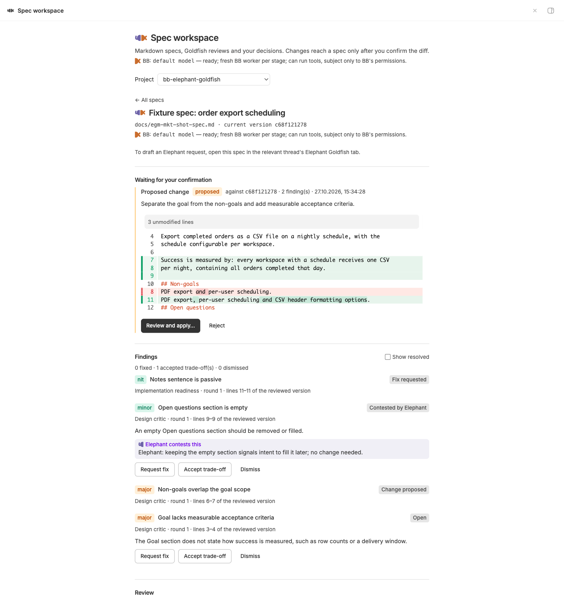

# Elephant Goldfish for BB

A spec workspace for [BB](https://getbb.app), adapting Google's
[Elephant-Goldfish Model](https://github.com/google/elephant-goldfish-model)
(EGM). Markdown specs stay in your checkout. A project page and a thread tab
show reviews, findings, decisions and proposed changes together.

[](screenshots/elephant-goldfish/spec-detail.png)

Long-form description for the BB Community marketplace: [PLUGIN_OVERVIEW.md](PLUGIN_OVERVIEW.md),
with current UI screenshots under [screenshots/](screenshots/).

## How it works

- **Elephant**: your normal BB conversation. It knows the project and the
  decisions that led to the spec. It contests findings with a rationale or
  proposes a revised document.
- **BB workers (default)**: each stage launches a new BB worker thread in the
  reviewed project's default (or selected thread) environment. Workers can use
  tools and write according to BB's permission mode, so this mode requires
  explicit installation-wide consent before the first launch.
- **Advanced endpoint**: a fresh, tool-less OpenAI-compatible model call. It
  receives only the reviewer persona, document standard, numbered spec and the
  context files you chose; it cannot read other files, run commands or change
  anything. Tool-call responses are rejected.
- **You**: decide findings, inspect proposed changes and explicitly confirm
  application. Automatic re-review follows a successfully applied change.

BB worker threads are not a sandbox. Revoking BB's own permissions changes what
workers can do; the plugin's consent records only that this installation may
launch them. Advanced endpoint reviews never use BB worker consent and never
fall back to BB workers. If the selected engine is unavailable, the launch is
refused with its reported reason.

## Install

Requires BB 0.47 or newer, Plugin SDK 0.6.79, and Node 24 for the development
checks.

```sh
npm install
npm run typecheck
npm test
npm run build
bb plugin install . --yes
```

The **Spec workspace** page appears in the sidebar, and an **Elephant Goldfish**
tab beside each conversation. Register an existing Markdown file to start.
Agent responses can include **Open document**, **View finding** and **Review
proposed change** links. Clicking opens the exact item in a thread detail tab,
including resolved findings and older proposals. A copied link opens the same
item on the Spec workspace page. Opening a link never applies a change.
The seven skills appear in BB's skill menu; after installing or reloading,
busy agent sessions get the new catalog only at the next safe session start.

### Reviewer engines

**BB workers** are the default and need no endpoint configuration. The launch
dialog describes their tool/write risk; cancelling it neither records consent
nor starts a review. The plugin stores each spawned worker ID with its stage,
stops and archives it after completion, cancellation or timeout, and attempts
the same cleanup during restart reconciliation.

Consent is installation-wide and revocable at any time from the same tab
(**Revoke BB worker consent**); revoked consent again refuses BB launches, including automatic next rounds, ad hoc re-reviews and restart continuations, and stops an in-flight run at its next stage without falling back to another engine.
Advanced endpoint launches never consult or record it.

**Advanced endpoint** is an optional tool-less mode. In the plugin settings,
choose `goldfish` for **Reviewer engine**, then set:

| Setting | Meaning |
|---|---|
| `goldfishBaseUrl` | OpenAI-compatible base URL, ending in `/v1`; it is displayed in the UI and reports, so never embed credentials in it |
| `goldfishModel` | Model id at that endpoint |
| `goldfishApiKey` | Bearer key, stored by BB in its plugin secret store |
| `goldfishApiKeyEnv` | Alternative: environment variable of the **BB server process** containing the key |
| `goldfishTimeoutSeconds` | Per-reviewer timeout, default 300 s |

Example (the key itself belongs in the masked settings field):

```sh
bb plugin config elephant-goldfish set reviewerEngine goldfish
bb plugin config elephant-goldfish set goldfishBaseUrl http://127.0.0.1:20128/v1
bb plugin config elephant-goldfish set goldfishModel auto/best-reasoning
bb egm status
```

With no configured or reachable selected engine, review launch is refused with a
reason. The plugin does not substitute an Elephant critique or another engine.

The configured key is only ever sent to the currently configured endpoint. If
the endpoint setting changes while a review (or a later round of it) is still
pending, that run fails with an "endpoint changed" message instead of pairing
the stored endpoint with the new key; start a fresh review. Endpoint error
messages report the HTTP status only — response bodies are never persisted or
rendered.

## Workflow

1. Add a Markdown spec on the project page or use the `egm_register_spec` agent tool.
   In a conversation's **Elephant Goldfish** tab, you can instead start with
   a guided brainstorm, draft from a brief or notes, or work on an existing
   document. Enter a short goal and search the actual workspace for files to
   include; selected files are shown before drafting. Empty, unavailable,
   failed and truncated search results are reported rather than invented.
2. Guided and contextual Elephant actions draft an editable request into the
   matching thread's BB composer. Review and edit it, then explicitly send it
   yourself; drafting never starts an Elephant turn. If the composer already
   contains text, mentions or attachments, choose **Append** or **Cancel**;
   appending preserves the existing draft. For thread-bound actions on the
   project page, open the relevant thread tab instead.
3. Start a review: full pipeline, feature spec, implementation readiness,
   brainstorm lenses, or custom reviewers. Both workspace views let you select
   the custom lenses and standard. Add context files if needed.
4. Read findings in the page or thread tab. **Request fix**, **Accept trade-off**
   (reason required), or **Dismiss**. A kept risk is not a fix.
5. Draft a request for the Elephant to resolve selected findings or propose a
   change. Contextual actions also support drafting from a concept, reviewing
   a diff and revising a rejected proposal with feedback. After you send the
   request, the Elephant uses `egm_contest` for a counterargument or
   `egm_propose` for a full revised document; it does not edit the spec directly.
   An agreed change need not address a finding: pass `findingIds: []` rather
   than inventing one. Every proposal is bound to the spec snapshot it read.
6. Inspect the diff and explicitly confirm **Apply change**. Coordinate with
   other editors: the version check does not lock them out. Applying from the
   proposal's own thread tab also drafts a short notification into that
   thread's composer, so the agent learns the change was applied once you send
   it; nothing is sent automatically.
7. After an applied change, once no finding remains unresolved, the next round
   starts automatically only if the file still matches the applied version. An
   ad hoc change is re-reviewed once outstanding findings are resolved, including
   partial findings from unsuccessful runs. If several ad hoc changes are applied
   while findings remain, only the latest matching applied version is re-reviewed.
   The review uses the latest recorded choices or the full preset defaults if none exist.
   If the file changed independently before re-review, start a fresh review. At the round
   limit the changed document is explicitly **not re-reviewed**. Cancellation,
   failure, partial output and stale versions are visible non-success states.

### From spec to implementation

The plugin covers the specification lifecycle only; it performs no commits or
issue sync and does not track implementation progress. Pair it with an issue
tracker for the build phase: see [docs/issue-tracking.md](docs/issue-tracking.md)
for the scope split and a recommended handoff (turn a clean, reviewed spec into
tracker issues).

### Seven skills

| Skill | Purpose |
|---|---|
| `egm-brainstorm` | Clarify an idea, write a concepts brief, stress-test with six lenses |
| `egm-draft` | Draft a design section by section with approval gates |
| `egm-review` | Staged review: zoom out → comprehension → critic → zoom out → readiness |
| `egm-review-loop` | Parallel chosen reviewers, resolution, confirmed changes, another round |
| `egm-resolve` | Elephant contests or proposes; the human decides and confirms |
| `egm-drift-report` | Read docs and code, report drift with evidence and unverified claims |
| `egm-bootstrap` | Bottom-up README contracts; ignore rules, no symlinks, approval above 15 directories |

Drafting, drift analysis and bootstrap are agent skills, not autonomous backend
jobs. Drift analysis is bounded reading and code search, **not** a guaranteed
AST scan. The review engine always reviews the whole document; upstream's
semantic-section scope is not exposed by this adaptation. Reviewer context is
an explicit reading list: linked files and URLs are not fetched automatically.

- Context is capped at 20 files and 400,000 characters. Omitted/missing context
  is recorded in the history. Advanced endpoint reviewers have no tools to fill
  the gaps; BB workers retain only BB's normal tool permissions.
- Apply checks the proposal's base version, retains a backup, atomically replaces
  the file and checks the result. It does not lock external editors: a concurrent
  edit may be overwritten or omitted, including writes through an open handle.
  Coordinate other writers before applying.
- After a restart, interrupted apply intents are reconciled from pre/post hashes;
  interrupted reviews become failed with partial results kept. Persisted BB
  worker IDs are best-effort stopped and archived before their interrupted
  stages are marked failed. If neither hash matches, the apply outcome is
  unknown, the backup is retained, and affected findings are released for
  decisions. The plugin never blindly re-applies a change.
- The plugin works with local project sources visible to the BB server. It
  does not currently read or apply specs on another enrolled machine.
  Workspace choices must correspond to the same authorized local checkout for
  operations on registered specs; an incompatible thread environment cannot
  silently target a different checkout.
- No commits or issue sync are performed by the plugin.

## Development

```sh
npm run typecheck  # strict TypeScript against the pinned BB SDK
npm test          # deterministic behavior tests; temporary workspaces and real SQLite
npm run build     # BB server and frontend bundles
bb plugin reload elephant-goldfish
```

The CLI `bb egm status` shows reviewer availability and registered specs.
`bb plugin rpc list elephant-goldfish` and `bb plugin rpc inspect` expose the
schema-validated RPC contract for scripts. RPC is a trusted local API; callers
with BB access have the same authority as the UI. Agent tools deliberately do
not include decision/apply operations, but this is not an authorization boundary
against a fully privileged BB agent that can invoke arbitrary CLI commands.

## Licensing

Repository-owned code is [MIT-licensed](LICENSE). Copied upstream EGM personas,
standards and original skills under [`upstream/`](upstream/) are Apache-2.0;
the adapted skills and bundled upstream references under [`skills/`](skills/)
retain Apache-2.0 licensing, with a license in each registered skill directory.
See [NOTICE](NOTICE) and [upstream/LICENSE](upstream/LICENSE) for provenance
and attribution. Local MIT licensing does not replace those obligations.
