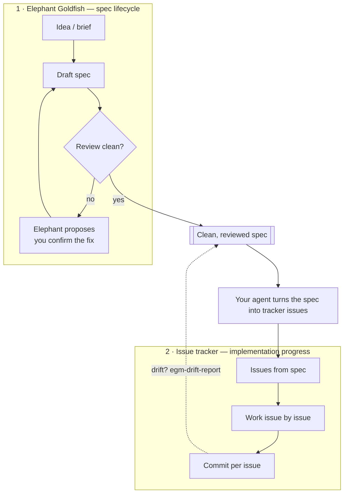

# Spec review and issue tracking

Elephant Goldfish covers one phase of a project: the **specification lifecycle** —
brainstorming, drafting, adversarial review, findings, decisions and applied
changes. It deliberately stops when a reviewed document is in place. It performs
no commits, pushes or issue sync, and it does not track implementation work.

Implementation progress — what is being built, what is done, what comes next —
belongs to an issue tracker. The two complement each other:

Phase 1 is a loop the plugin owns: review, findings, proposals — until the
spec is clean. One handoff: your agent turns the finished spec into tracker
issues. Phase 2 belongs to the tracker; the dashed edge checks code against
the spec afterwards. The plugin never writes issues, commits or code itself —
every change passes your confirmation.

| | Elephant Goldfish | Issue tracker (e.g. Airbender with Beads) |
|---|---|---|
| Artifact | Markdown spec in your checkout | Issues with steps, sizes, reviews |
| Question answered | "Is the design sound and agreed?" | "What is being built, and how far along is it?" |
| Progress surface | Spec workspace page, Elephant Goldfish thread tab | Tracker tab/CLI in BB |
| Human gate | Finding decisions, confirming applied changes | Definition/plan/work reviews, commits |

## Recommended handoff

1. Bring the spec to a clean state: no unresolved findings, applied changes
   re-reviewed.
2. Ask your agent to turn the spec into tracker issues — one epic plus one
   sub-issue per independently implementable section, each with a size and a
   done criterion. In an Airbender/Beads repo that is `bend create`; keep all
   issue work behind `bend` rather than the tracker's own CLI or website.
3. Implement issue by issue. The spec remains the reference; when code and spec
   drift apart, `egm-drift-report` reports where.
4. If a change invalidates part of the spec, revise it through the plugin
   (proposal + confirmed apply), not by silently editing the document.

No tracker is required to use the plugin, and the plugin works unchanged
alongside whichever tracker (or none) your repository uses.
